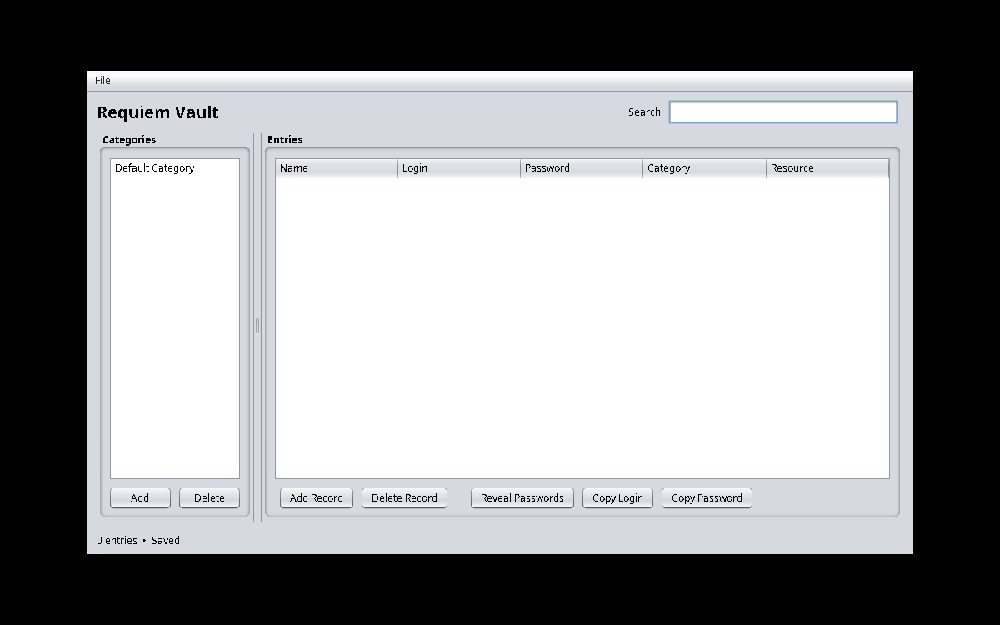

# Requiem

A desktop password vault made with Java 17 and Swing.



## Features

- Save passwords in an encrypted `.vault` file
- Add, edit, search and group entries by category
- Generate random passwords
- Hide/show passwords and copy them to the clipboard
- Warn about unsaved changes
- Ask before overwriting an existing vault

Vaults are encrypted with AES-256-GCM. The encryption key comes from a master password using PBKDF2-HMAC-SHA256 and a random salt. A new IV is generated for each save.

**Note:** this is a learning project, not a security-audited password manager. I wouldn't use it for important real accounts.

## Run

Requires JDK 17+ and Maven.

```bash
mvn clean package
java -jar target/requiem-1.0.0.jar
```

You can also open the Maven project in IntelliJ IDEA and run `Main.java`.

## Tests

```bash
mvn test
```

The tests cover encryption/decryption, wrong passwords, saving files, password generation and table behavior.

